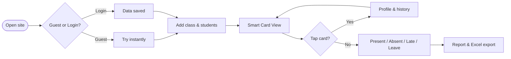

<div align="center">



<br>

<a href="https://github.com/YOUR-USERNAME/classroll-pro">
  
</a>

<p>
  
  
  
  
</p>

<p>
  <a href="#-live-demo"><b>Live Demo</b></a> &nbsp;·&nbsp;
  <a href="#-features"><b>Features</b></a> &nbsp;·&nbsp;
  <a href="#-quick-start"><b>Quick Start</b></a> &nbsp;·&nbsp;
  <a href="#-deploy-to-vercel"><b>Deploy</b></a> &nbsp;·&nbsp;
  <a href="#-roadmap"><b>Roadmap</b></a>
</p>


</div>

## 🌐 Live Demo

> **[Open ClassRoll Pro →](https://YOUR-PROJECT.vercel.app)**
> Guest mode works instantly. Log in only when you want to save your data.

<div align="center">
  
</div>

<br>

## ✨ Why ClassRoll Pro?

Most attendance apps show a long list and ask teachers to tick names. **ClassRoll Pro shows one student at a time**, with a big photo and giant buttons. Teachers recognise faces faster, make fewer mistakes, and never scroll.

| Typical attendance app | ClassRoll Pro |
|---|---|
| Long list, constant scrolling | One **Smart Card** per student |
| Small tick boxes | Huge **Present / Absent** buttons |
| Names only | **Photo, roll, guardian phone, history** |
| Hard to correct mistakes | Open profile, **Back & correct** in one tap |
| English only | **Bangla + English**, Bangla numerals |

## 🚀 Features

<table>
<tr>
<td width="50%" valign="top">

### 🃏 Smart Card View
- One student per card, large photo
- Big **Present / Absent**, plus **Late / Leave**
- Tap a card to open the **full profile**
- **Back & correct** without losing your place
- Progress bar for the day

</td>
<td width="50%" valign="top">

### 👥 Classes & Students
- Create class, section and subject
- Add students manually
- **Excel import** with a downloadable template
- Student photo upload (auto-cropped, auto-resized)
- Clear Bangla/English error messages

</td>
</tr>
<tr>
<td width="50%" valign="top">

### 📊 Reports & Alerts
- Per-student attendance percentage
- **Low-attendance alert** under 75%
- One-click **Excel report** download
- "Mark everyone present" button

</td>
<td width="50%" valign="top">

### 🎨 Premium Experience
- Fully responsive: phone, tablet, desktop
- **Bangla / English** toggle at the very top
- Light and **dark mode**
- Smooth card animation
- Guest mode, login only to save

</td>
</tr>
</table>

## 🔄 How It Works



## 🛠 Tech Stack

<p>
  
  
  
  
  
</p>

Pure HTML, CSS and JavaScript. No framework, no build step, no `npm install`.

## 📁 Project Structure

```
classroll-pro/
├── index.html          # page markup
├── css/
│   └── style.css       # design system, light/dark themes, responsive layout
├── js/
│   └── app.js          # translations, card view, students, reports, auth demo
├── assets/
│   ├── favicon.svg
│   ├── banner.svg      # animated README banner
│   ├── divider.svg
│   └── preview.svg
├── vercel.json
└── README.md
```

## ⚡ Quick Start

**Option 1: Live Server (VS Code)**
1. Open the folder in VS Code
2. Install the **Live Server** extension
3. Right click `index.html` → **Open with Live Server**

**Option 2: Terminal**
```bash
# Python
python -m http.server 5500

# or Node.js
npx serve .
```
Then open **http://localhost:5500**

## ☁️ Deploy to Vercel

```bash
git init
git add .
git commit -m "ClassRoll Pro first version"
git branch -M main
git remote add origin https://github.com/YOUR-USERNAME/classroll-pro.git
git push -u origin main
```

1. Go to [vercel.com](https://vercel.com) → **Add New → Project**
2. Import your GitHub repository
3. Framework Preset: **Other** (leave Build Command and Output Directory empty)
4. Click **Deploy** 🎉

Every `git push` to `main` will redeploy automatically.

## 🧭 Roadmap

- [x] Smart Card View with profile and correction flow
- [x] Excel import and Excel report export
- [x] Bangla / English toggle, dark mode
- [x] Guest mode and demo login
- [ ] Real accounts and cloud sync (Firebase / Supabase)
- [ ] Parent SMS / notification on absence
- [ ] Offline mode with auto sync (PWA)
- [ ] Excel template with embedded student photos
- [ ] PDF report
- [ ] School plan: multiple teachers and admin dashboard
- [ ] Native mobile app (Flutter / React Native)

## 💎 Plans (Concept)

| | Free | Pro | School |
|---|:---:|:---:|:---:|
| Classes | 1 | Unlimited | Unlimited |
| Students | 30 | Unlimited | Unlimited |
| Reports | ✅ | ✅ | ✅ |
| SMS alerts | – | ✅ | ✅ |
| Offline sync | – | ✅ | ✅ |
| Multiple teachers & admin | – | – | ✅ |

## ⚠️ Prototype Notes

- Login and saved data are a **demo**. They live only in the visitor's browser (`localStorage`). Real accounts need a backend.
- The Excel library loads from a CDN, so an internet connection is needed for import/export.
- SMS, offline sync and payments are shown as planned features and are not implemented yet.

<details>
<summary><b>🇧🇩 বাংলায় সংক্ষেপে</b></summary>

<br>

**ClassRoll Pro** শিক্ষকদের জন্য কার্ড-ভিত্তিক অ্যাটেনডেন্স ওয়েবসাইট। লিস্ট স্ক্রল করার বদলে প্রতিটি স্টুডেন্টের কার্ড দেখা যায়, বড় ছবি আর বড় **উপস্থিত / অনুপস্থিত** বাটনসহ। কার্ডে ট্যাপ করলে পুরো প্রোফাইল খোলে, আর ফিরে এসে সহজে সংশোধন করা যায়।

- বাংলা ও ইংরেজি ভাষা, এক ক্লিকে পরিবর্তন
- Excel ইমপোর্ট ও রিপোর্ট ডাউনলোড
- ৭৫% এর নিচে উপস্থিতি গেলে সতর্কতা
- মোবাইল, ট্যাবলেট ও ডেস্কটপে চলে, ডার্ক মোড আছে

</details>

<details>
<summary><b>❓ FAQ</b></summary>

<br>

**Do I need to install anything?** No. Open `index.html` or use Live Server.

**Is my data safe?** In this prototype data stays in your own browser only. Nothing is sent to a server.

**Can I change the name "ClassRoll Pro"?** Yes. Search and replace it in `index.html`, `js/app.js` and `README.md`.

</details>

<br>

<div align="center">


<br>

**Made with ❤️ for teachers**

<sub>If you like this project, give it a ⭐ on GitHub</sub>

</div>
